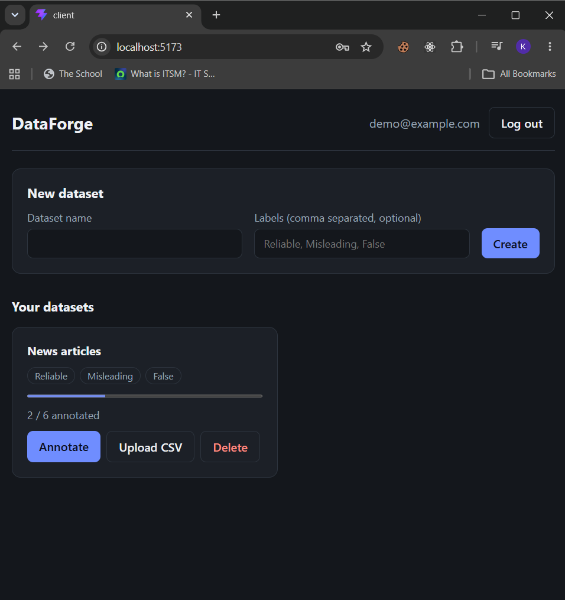
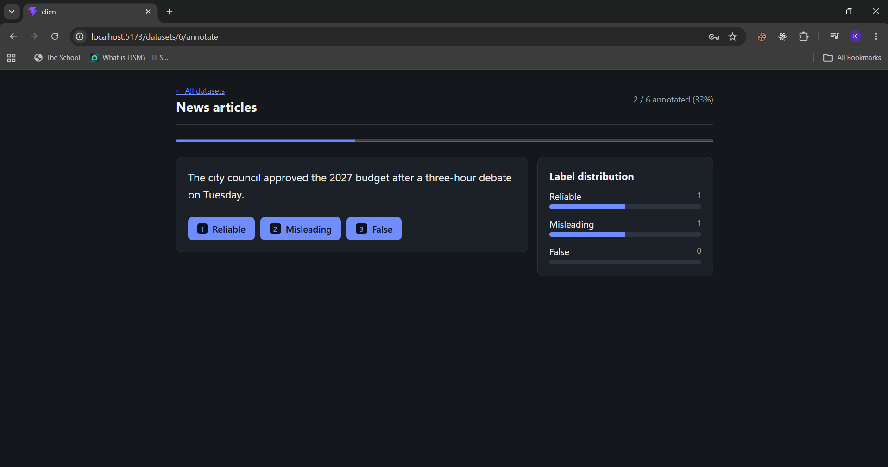

# DataForge

A full-stack web app for labelling text datasets. Upload a CSV of text samples, define your own labels, then annotate the samples one by one, with keyboard shortcuts, live progress and a label distribution chart.

> **Status:** the core workflow works locally. Automated tests and deployment are in progress.



## Features

- Register and log in with session-based authentication
- Create datasets with custom labels (default: Reliable, Misleading, False)
- Upload a CSV of text samples (comma or semicolon separated, up to 2 MB and 5,000 rows)
- Annotation screen: one sample at a time, label buttons, keys 1-9 as shortcuts
- Progress bar and per-label distribution, computed on the server
- Every user can only see and modify their own datasets

## Tech stack

| Layer | Technology |
|---|---|
| Frontend | React, TypeScript, Vite, React Router |
| Backend | Node.js, Express (ES modules) |
| Database | PostgreSQL (hosted on Supabase), `pg` driver with plain SQL |
| Authentication | `express-session` with sessions stored in PostgreSQL, `bcrypt` password hashing |
| Uploads | `multer` (multipart parsing), `csv-parse` |

## Architecture

The React app is a single-page application that talks to an Express JSON API. The API reads and writes PostgreSQL through a connection pool. After login, the API stores the user's id in a server-side session and sends the browser a signed session cookie (`HttpOnly`, `SameSite=Lax`). The browser attaches that cookie to every API request, so the frontend never handles a password or token after login.

```
React (localhost:5173)  --fetch + cookie-->  Express API (localhost:4000)  --pg-->  PostgreSQL
```

## Getting started

**Prerequisites:** a recent LTS version of Node.js and a PostgreSQL database (I used Supabase).

**1. Clone the repository**

```bash
git clone https://github.com/anochi3/dataforge.git
cd dataforge
```

**2. Create the database tables.** Run the contents of `server/db/schema.sql` in your database's SQL editor. It creates the `users`, `datasets`, `samples`, `annotations` and `session` tables.

**3. Start the API**

```bash
cd server
npm install
```

Copy `.env.example` to `.env` and fill in the three values:

```
DATABASE_URL=your PostgreSQL connection string
SESSION_SECRET=a long random string
PORT=4000
```

To generate a session secret: `node -e "console.log(require('crypto').randomBytes(32).toString('hex'))"`

Then start it:

```bash
npm run dev
```

> `server/src/db.js` enables SSL, which Supabase requires. For a local PostgreSQL without SSL, remove the `ssl` option there.

**4. Start the frontend** (in a second terminal)

```bash
cd client
npm install
```

Copy `.env.example` to `.env` and set:

```
VITE_API_URL=http://localhost:4000
```

```bash
npm run dev
```

**5. Open the app** at `http://localhost:5173`. Use `localhost`, not `127.0.0.1`: the API only allows requests from the exact origin `http://localhost:5173`.

## CSV format

The first row must be a header containing a `text` column. Other columns are ignored.

```csv
text
"Scientists confirm the new vaccine reduces hospital admissions by 40%."
"BREAKING: Drinking lemon water cures every known disease."
```

A ready-made example is in `server/sample-data/articles.csv`.

## API overview

All routes except register and login require a logged-in session.

| Method | Route | Purpose |
|---|---|---|
| POST | `/api/auth/register` | Create an account and log in |
| POST | `/api/auth/login` | Log in |
| POST | `/api/auth/logout` | Destroy the session |
| GET | `/api/auth/me` | Return the current user |
| GET, POST | `/api/datasets` | List your datasets with progress counts / create one |
| GET, DELETE | `/api/datasets/:id` | Get / delete one dataset |
| POST | `/api/datasets/:id/samples` | Upload a CSV of samples (multipart field `file`) |
| GET | `/api/datasets/:id/samples` | List samples (paginated) with your label |
| GET | `/api/datasets/:id/samples/next` | First sample you have not labelled yet |
| PUT | `/api/datasets/:id/samples/:sampleId/annotation` | Save or change your label for a sample |
| GET | `/api/datasets/:id/stats` | Progress and label distribution |

## Design decisions

- **Server-side sessions instead of JWTs.** For a first-party web app, a session is simple and can be revoked immediately by deleting its row. Sessions are stored in PostgreSQL so they survive server restarts.
- **Plain SQL with `pg` instead of an ORM.** Every query uses parameter placeholders (`$1`, `$2`), which prevents SQL injection, and the joins and aggregations are written out explicitly.
- **Authorization inside the SQL.** Queries filter on `owner_id` taken from the session, never from the request. Requests for another user's data return `404`, not `403`, so the existence of a dataset is not revealed.
- **Upsert for annotations.** `unique (sample_id, user_id)` plus `on conflict ... do update` means re-labelling a sample updates one row, with no race between a check and an insert.
- **Bulk insert for CSV rows.** One `insert ... select unnest($2::text[])` statement stores all samples atomically instead of one query per row.
- **Server-computed progress.** The frontend re-reads stats and the next sample from the API after each label, so the screen always matches the database.

## Security notes

- Passwords are hashed with bcrypt (salted, cost factor 10) and never stored in plain text.
- The session ID is regenerated at login and registration to prevent session fixation.
- Cookies are `HttpOnly` and `SameSite=Lax`. They must be set to `Secure` when served over HTTPS.
- Uploads are limited to 2 MB and 5,000 rows, and ids and labels are validated on the server.

## Known limitations and roadmap

- No automated tests yet (API tests with Supertest are next)
- Not deployed yet
- No rate limiting on login, no email verification and no password reset
- A labelled sample cannot be changed from the interface yet (the API already supports it)
- No export of annotated data
- Datasets belong to one user, so there is no multi-annotator workflow or agreement metrics yet

## Project structure

```
client/                React + TypeScript frontend (Vite)
  src/api.ts           fetch wrapper (cookies, JSON and multipart bodies, errors)
  src/auth/            authentication context and provider
  src/pages/           login/register, dashboard, annotation screen
  src/components/      dataset card, create form, route guard
server/
  db/schema.sql        database schema
  sample-data/         example CSV files
  src/index.js         app setup: CORS, sessions, routes, error handler
  src/db.js            PostgreSQL connection pool
  src/routes/          auth, datasets, annotations
  src/middleware/      requireAuth
```
